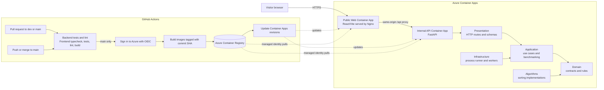

# AlgoLab

**Algorithms racing through data, from sorting to graphs, search, dynamic programming, and backtracking.**

AlgoLab is an interactive learning and experimentation platform for seeing how algorithms
work, comparing their operations, and measuring their performance. The current site focuses
on sorting; its design and architecture are being prepared to grow into other algorithm
families.

## What you can do today

- **Race:** choose up to ten sorting algorithms, generate one integer array, and watch each
  algorithm sort the same input step by step. Play, pause, step, replay, scrub through the
  trace, and adjust playback speed. Compare, swap, write, and sorted states are highlighted.
- **Benchmark:** measure the selected algorithms on one dataset with configurable size,
  value range, distribution, repeats, and warm-ups. Compare median runtime, comparisons,
  swaps, and array writes. Timing applies to that run and machine only.
- **Suite:** compare the same algorithms across input sizes and distributions. Charts show
  how operation counts or measured runtime grow as the input changes.
- **Shared experiments:** algorithm selection is shared by Race, Benchmark, and Suite.
- **Input patterns:** random, sorted, reversed, nearly sorted, and few-unique values.
- **Themes and controls:** dark and light themes, reproducible seeds, and keyboard playback
  shortcuts.

The current sorting algorithms are Selection, Bubble, Odd-Even, Cocktail, Insertion, Binary
Insertion, Frequency (Counting), Shell, Heap, Quick, and Merge Sort. The API also describes
each algorithm's time and auxiliary-space complexity. Trace output is limited to 128 values so
that playback remains useful and responsive.

## Planned algorithm areas

The category tabs show the direction of future work. Only **Sorting** is implemented and
active today; the other tabs are placeholders, not working features yet.

- **Searching:** Linear Search and Binary Search.
- **Graphs and paths:** BFS, DFS, Dijkstra, and A* with a graph-based visualization.
- **Dynamic Programming:** Fibonacci, Knapsack, and Longest Common Subsequence with a step-by-step table.
- **Backtracking:** maze solving and N-Queens with visible choices and backtracks.

## Architecture

The repository keeps the React/Vite frontend and FastAPI backend as separate applications.
The API is a modular monolith: HTTP routes call application use cases, which rely on domain
contracts and registered algorithm implementations. Infrastructure adapters handle process
execution and runtime concerns. The frontend talks to the API over HTTP and does not import
backend code.



Pull requests run checks without deploying. A successful push to `main` builds and publishes
the API and web images, then updates the existing Azure Container Apps. The current Azure
configuration uses a public web app and a private API behind the Nginx proxy. GitHub Actions
authenticates with Azure through OIDC; it does not store a long-lived Azure client secret.

The deployment workflow updates provisioned resources; it does not create Azure infrastructure.
See the [Azure CI/CD setup guide](docs/GITHUB-AZURE-CICD.md) for the one-time setup and
[manual infrastructure guide](infra/DEPLOY-MANUALLY.md) for first-time provisioning.

## Run the full stack with Docker

Requires Docker Engine and the Docker Compose plugin.

```bash
cp .env.example .env
docker compose up --build -d
```

Open the site at <http://127.0.0.1:8081>. The API and interactive documentation are also
available at <http://127.0.0.1:8000/docs>; health is at <http://127.0.0.1:8000/health>.
The frontend proxies API requests through its own origin, so the browser does not need a
separate CORS configuration. To stop the stack:

```bash
docker compose down
```

Set `ALGOLAB_WEB_PORT` or `ALGOLAB_PORT` in `.env` to change the host ports. See
[Running AlgoLab](docs/RUNNING.md) for development setup, configuration, limits, and
troubleshooting.

## API at a glance

- `GET /health` — service status.
- `GET /api/v1/algorithms` — available algorithms and complexity metadata.
- `POST /api/v1/datasets` — generate reproducible test data.
- `POST /api/v1/sort` — sort arrays and optionally return operation traces.
- `POST /api/v1/benchmarks` — measure repeated runs on one array.
- `POST /api/v1/benchmark-suites` — compare sizes and input patterns.

Read the [API guide](docs/API.md) for request schemas, responses, and limits.

## Project guides

- [Architecture and folder layout](docs/ARCHITECTURE.md)
- [Algorithms and complexity](docs/ALGORITHMS.md)
- [Benchmark interpretation](docs/BENCHMARKING.md)
- [Running locally and with Docker](docs/RUNNING.md)
- [GitHub Actions and Azure deployment](docs/GITHUB-AZURE-CICD.md)
- [Contributing](CONTRIBUTING.md)
- [Frontend-to-algorithm flow (Arabic)](docs/FRONTEND-FLOW-AR.md)
